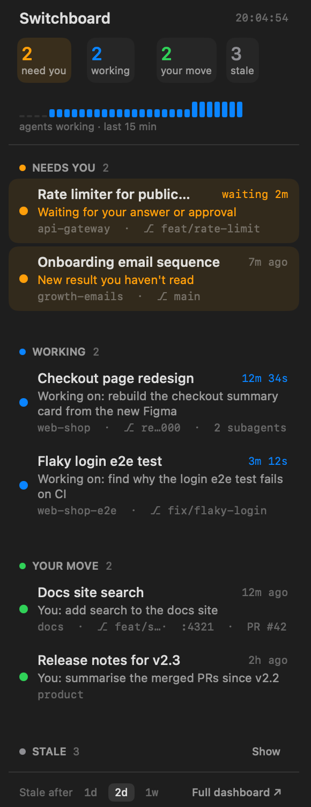

# Switchboard for cmux

A [cmux](https://cmux.com) sidebar panel that shows which of your coding agents need you, which are working, which are waiting for your next step, and which went stale. Tap a row to jump straight to that terminal.



## Install

```bash
mkdir -p ~/.config/cmux/sidebars && \
curl -fsSL https://raw.githubusercontent.com/mbonete/cmux-switchboard-panel/main/switchboard.js \
  -o ~/.config/cmux/sidebars/switchboard.js && \
cmux right-sidebar set custom switchboard
```

That saves one file and opens it in cmux's right sidebar. To use it as the left sidebar instead, right-click the sidebar button and pick **switchboard**.

To update, run the same command again. To remove it, delete `~/.config/cmux/sidebars/switchboard.js`.

## What it shows

| Section | What lands there |
| --- | --- |
| **Needs you** | An agent that can't go on until you act: a permission request, a question or a plan to approve. Longest wait first. |
| **Working** | Agents mid-turn, with a live timer, what you asked, and how many subagents are running. |
| **Your move** | Agents that finished and are waiting for your next message. Replies you haven't read come first, marked unread. |
| **Stale** | No activity for longer than the "Stale after" setting (1 day, 2 days or 1 week). Collapsed until you tap **Show**. |

Where each situation goes:

| Situation | Section |
| --- | --- |
| Claude shows a permission request, a multiple-choice question or a plan to approve | Needs you |
| Claude is mid-turn, with or without subagents | Working |
| Turn ended, but a job it started in that turn is still running (a build, a dev server) | Working, with a "Quiet for …" note after 10 minutes |
| Turn ended, only background work from an earlier turn still running | Your move, after 2 quiet minutes if the reply is unread, otherwise after 10 |
| Finished, reply unread | Your move, listed first |
| Finished, reply read | Your move |
| No activity for longer than "Stale after" | Stale |

Questions Claude writes into its reply as plain text, like grill-me's rounds, count as a finished turn: the panel can't read replies.

Each row also shows the project folder, git branch (`•` when there are uncommitted changes), dev-server ports, and the pull request when cmux knows one. The strip under the counters shows how many agents were working over the last 15 minutes.

- **Tap a row:** jump to that workspace and terminal.
- **Right-click a row:** Open in cmux, Mark read, or Open full dashboard.

## Requirements and limits

- cmux with Custom Sidebars turned on. It is a beta feature, on by default, under **Settings → Custom Sidebars**. Built on cmux 0.65.2.
- It reads cmux's own list of agent sessions, so it should show any agent cmux tracks. It has only been tested with Claude Code.
- It reads cmux's local data only and sends nothing anywhere.
- cmux sidebars can't read files or the network, so the panel can't show what an agent replied, and you can't approve or reply from it. Tap through to the terminal for that.
- A working agent triggers a hook at every tool call. When an agent cmux calls working has done nothing for 10 minutes and has no subagent running, the panel keeps it under **Working** and notes how long it has been quiet. Either it is waiting on something in the background, such as a long build, or it finished and cmux never heard about it. That happens now and then, and cmux then reports the agent as working until your next prompt (the optional Stop hook below fixes that). The panel can't tell the two apart, with one exception. If the background work started before your last prompt, as a dev server from an earlier turn does, the agent goes under **Your move** once it has been quiet for 2 minutes with an unread reply, the same way cmux's own sidebar shows it as waiting. Without an unread reply, because you already read it or because the agent is still mid-turn on a long command, it waits 10 quiet minutes. So in such a session a single command longer than 10 minutes shows the agent under **Your move** until the command ends.
- The activity strip starts filling when cmux loads the panel. The "Stale after" choice goes back to 2 days when cmux reloads it.

## Optional: the Stop hook

cmux now and then misses the end of a turn and keeps showing the agent as working until your next prompt, in its own sidebar and in this panel. A small Claude Code hook fixes that. It runs each time Claude finishes a turn, checks that cmux recorded it, and sends it again if not.

```bash
mkdir -p ~/.claude/hooks && \
curl -fsSL https://raw.githubusercontent.com/mbonete/cmux-switchboard-panel/main/stop-hook.sh \
  -o ~/.claude/hooks/switchboard-stop.sh
```

Then add it as a Stop hook in `~/.claude/settings.json`, next to any hooks you already have:

```json
"hooks": {
  "Stop": [
    { "hooks": [{ "type": "command", "command": "sh $HOME/.claude/hooks/switchboard-stop.sh", "timeout": 10 }] }
  ]
}
```

It needs `jq`, which macOS 15 and later include, and does nothing outside cmux. Normally it adds a few hundredths of a second to the end of a turn, and about 2 seconds when cmux is slow to record it. To check, it reads cmux's own session file, so a cmux update that changes that file turns the hook off until it's updated.

## Optional: the full web dashboard

**Full dashboard ↗** opens [cmux-switchboard](https://github.com/mbonete/cmux-switchboard) on `localhost:4747`, if you run it. It's a separate local web app that adds Claude's recaps, approving permissions and answering questions from the page, and quick replies. The panel works fine without it.

## Customize

Edit `~/.config/cmux/sidebars/switchboard.js` and save; cmux reloads it right away. Colors and the dashboard URL are at the top of the file.

## License

MIT. See [LICENSE](LICENSE).
